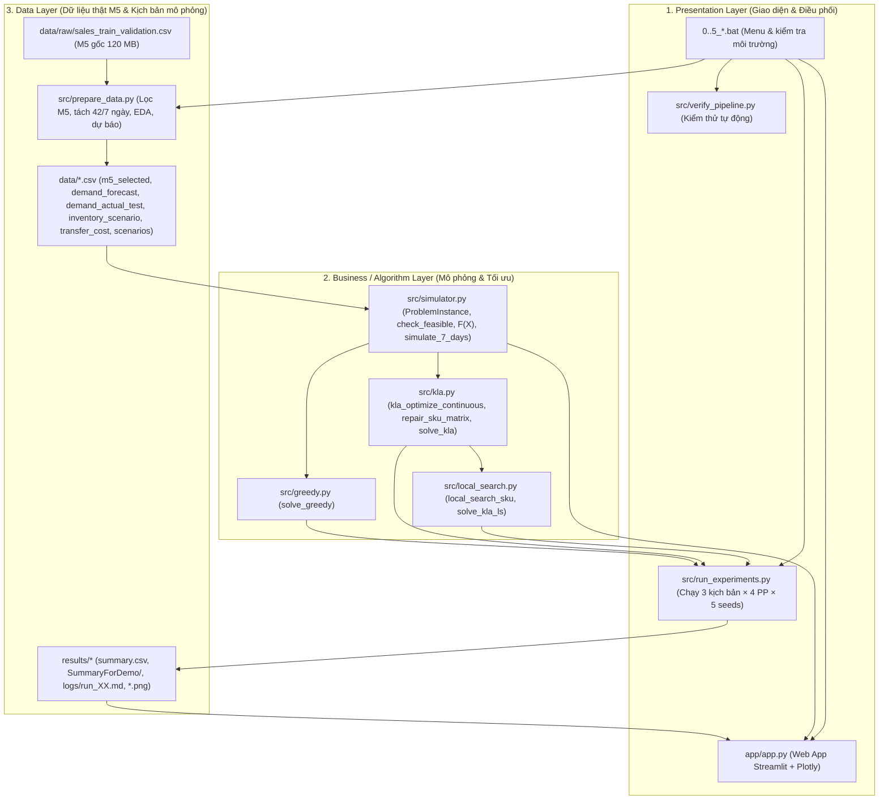

# Tối Ưu Điều Chuyển Tồn Kho Đa Cửa Hàng Bằng Thuật Toán Lai KLA–LS

Tài liệu kỹ thuật chi tiết này mô tả toàn bộ bài toán **Tối ưu điều chuyển tồn kho đa cửa hàng dưới nhu cầu bất định** của **Team Chuyển Kho — HUIT Data Science Challenge 2026** theo đúng mã nguồn thực tế của dự án, trình bày theo **kiến trúc 3 lớp**, có đầy đủ **công thức toán học**, **ví dụ thế số tính tay từ dữ liệu thật**, **đối chiếu mã gốc `KLA.m`** và **phân tích chi tiết từng module**.

---

## 0. Mục tiêu bài toán & Tổng quan kết quả

### 0.1. Đầu vào, đầu ra và phạm vi khóa (MVP Vòng Sơ khảo)

- **Input:**
  - **Dữ liệu doanh số thật:** Trích từ bộ dữ liệu công khai **Kaggle M5 Forecasting – Accuracy** (`data/raw/sales_train_validation.csv`, 120 MB), khóa phạm vi **04 cửa hàng** (`CA_1`, `CA_2`, `CA_3`, `CA_4`) × **03 sản phẩm** (`FOODS_3_090`, `FOODS_3_586`, `FOODS_3_252`) × **49 ngày cuối** (`d_1865..d_1913`) = **588 quan sát thật** (`0 NaN`, `0 âm`, `0 ngày bằng 0`).
  - **Thông số vận hành mô phỏng minh bạch:** Tồn kho đầu kỳ, ngưỡng an toàn, sức chứa (`data/inventory_scenario.csv`), ma trận cước điều chuyển (`data/transfer_cost.csv`) và 3 kịch bản biến động cầu (`data/scenarios.csv`), công bố đầy đủ trong `docs/assumptions.md`.
- **Output:**
  - Ma trận lệnh điều chuyển nguyên không âm $X = \{x_{ijk}\} \in \mathbb{Z}_{\ge 0}^{4 \times 4 \times 3}$ thực hiện ngay đầu kỳ 7 ngày.
  - Bảng đánh giá thực nghiệm (`results/summary.csv` — 36 dòng), 6 biểu đồ PNG (`results/eda_01..03.png`, `compare_cost.png`, `compare_service.png`, `convergence_kla.png`), nhật ký chạy tự động (`results/experiment_log.md`, `results/logs/run_XX.md`).
  - Ứng dụng hỗ trợ ra quyết định tương tác 1 trang bằng Streamlit (`app/app.py`).
- **Mô hình tối ưu & đối chứng:** `No Transfer`, `Greedy`, `KLA` (thuần) và **`KLA–LS`** (lai Memetic giữa *Kirchhoff's Law Algorithm* và *Local Search* 3 lân cận).

### 0.2. Bảng kết quả thực nghiệm tổng hợp (đánh giá trên tập kiểm tra 7 ngày, 5 seeds `42..46`)

| Kịch bản | Phương pháp | Tổng chi phí (USD) (Mean ± Std) | Giảm so với No Transfer | Cước chuyển (USD) | Phạt thiếu hàng (USD) | Phí tồn dư (USD) | Thiếu hàng (đv) | Fill Rate (%) | Hàng chuyển (đv) | Thời gian (s) |
| :--- | :--- | :---: | :---: | :---: | :---: | :---: | :---: | :---: | :---: | :---: |
| **NORMAL** | No Transfer | 5,532.5 ± 0.0 | Mốc 0% | 0.0 | 4,710.0 | 822.5 | 471.0 | 87.40% | 0 | 0.00001 |
| NORMAL | Greedy | 1,946.0 ± 0.0 | -64.8% | 655.5 | 670.0 | 620.5 | 67.0 | 98.21% | 437 | 0.00011 |
| NORMAL | KLA (thuần) | 1,972.7 ± 55.2 | -64.3% | 684.3 | 668.0 | 620.4 | 66.8 | 98.21% | 449.6 | 0.119 |
| NORMAL | **KLA–LS** | **1,946.0 ± 0.0** | **-64.8%** | **655.5** | **670.0** | **620.5** | **67.0** | **98.21%** | **437** | **0.134** |
| **FLASH_SALE (+30%)** | No Transfer | 6,675.5 ± 0.0 | Mốc 0% | 0.0 | 5,853.0 | 822.5 | 585.3 | 84.81% | 0 | 0.000003 |
| FLASH_SALE (+30%) | Greedy | 2,415.0 ± 0.0 | -63.8% | 905.5 | 933.0 | 576.5 | 93.3 | 97.58% | 549 | 0.00010 |
| FLASH_SALE (+30%) | KLA (thuần) | 2,430.6 ± 63.3 | -63.6% | 1,005.1 | 853.0 | 572.5 | 85.3 | 97.79% | 586.2 | 0.126 |
| FLASH_SALE (+30%) | **KLA–LS** | **2,415.0 ± 0.0** | **-63.8%** | **905.5** | **933.0** | **576.5** | **93.3** | **97.58%** | **549** | **0.147** |
| **SURGE (+50%)** | No Transfer | 7,437.5 ± 0.0 | Mốc 0% | 0.0 | 6,615.0 | 822.5 | 661.5 | 83.16% | 0 | 0.000002 |
| SURGE (+50%) | Greedy | 2,585.0 ± 0.0 | -65.2% | 1,090.5 | 955.0 | 539.5 | 95.5 | 97.57% | 623 | 0.00016 |
| SURGE (+50%) | KLA (thuần) | 2,585.3 ± 37.5 | -65.2% | 1,116.0 | 931.0 | 538.3 | 93.1 | 97.63% | 632.4 | 0.125 |
| SURGE (+50%) | **KLA–LS** | **2,585.0 ± 0.0** | **-65.2%** | **1,090.5** | **955.0** | **539.5** | **95.5** | **97.57%** | **623** | **0.142** |

---

## 1. Ý tưởng cốt lõi: từ Điều chuyển cơ bản đến KLA và Lai KLA–LS

### 1.1. Bản chất bài toán điều chuyển tồn kho nội bộ (*Lateral Transshipment*)

Trong hệ thống bán lẻ đa cửa hàng, nhu cầu thực tế phân bố lệch theo địa điểm và biến động ngắn hạn:
- Cửa hàng thiếu hàng (`CA_1`) bị hụt doanh thu và mất khách, chịu chi phí phạt thiếu hàng $p = 10.0$ USD/đv.
- Cửa hàng dư hàng (`CA_2`, `CA_3`) bị đọng vốn và tốn chi phí lưu kho tồn dư $h = 0.5$ USD/đv.
- Nếu điều chuyển 1 đơn vị từ `CA_2` (đang dư) sang `CA_1` (đang thiếu) với cước $c_{\text{CA\_2},\text{CA\_1}} = 1.5$ USD:
  - Chi phí giảm được: $p + h = 10.0 + 0.5 = 10.5$ USD.
  - Chi phí bỏ ra: $1.5$ USD.
  - **Lợi ích ròng ngay lập tức:** $10.5 - 1.5 = 9.0$ USD cho mỗi đơn vị hàng!

Gọi $x_{ijk} \in \mathbb{Z}_{\ge 0}$ là số đơn vị sản phẩm $k$ chuyển từ cửa hàng $i$ sang cửa hàng $j$ ngay đầu kỳ. Tồn kho sau điều chuyển tại cửa hàng $i$ cho sản phẩm $k$ là:

$$
I_{ik}^{\text{after}} = I_{ik}^{\text{before}} + \sum_{j \ne i} x_{jik} - \sum_{j \ne i} x_{ijk}
$$

**Tính chất bảo toàn hàng hóa:** Tổng tồn kho toàn mạng lưới trước và sau điều chuyển luôn bằng nhau:

$$
\sum_{i=1}^{S} I_{ik}^{\text{after}} = \sum_{i=1}^{S} I_{ik}^{\text{before}}, \quad \forall k \in \{1, \dots, K\}
$$

### 1.2. Hệ ràng buộc cứng & Hàm mục tiêu thống nhất

Mọi phương án điều chuyển $X = \{x_{ijk}\}$ bắt buộc thỏa mãn đồng thời **5 điều kiện khả thi**:

1. **Nguyên không âm:** $x_{ijk} \in \mathbb{Z}_{\ge 0}, \quad \forall i, j, k$.
2. **Không tự chuyển cho chính mình:** $x_{iik} = 0, \quad \forall i, k$.
3. **Không chuyển hai chiều ngược nhau trên cùng một cặp cửa hàng:** $\min(x_{ijk}, x_{jik}) = 0, \quad \forall i < j, k$.
4. **Không xuất vượt lượng dư an toàn của kho gửi** (kho đi cứu bạn không được tự đẩy mình vào cảnh thiếu hàng):

$$
\sum_{j \ne i} x_{ijk} \le M_{ik} = \max\left(0,\, I_{ik}^{\text{before}} - S_{ik}\right), \quad \forall i, k
$$

5. **Không nhận vượt sức chứa kho nhận và không âm tồn sau chuyển:**

$$
0 \le I_{jk}^{\text{after}} \le \text{Cap}_{jk}, \quad \forall j, k
$$

**Hàm mục tiêu cần cực tiểu hóa (đơn vị: USD):**

$$
F(X) = \underbrace{\sum_{i,j,k} c_{ij} x_{ijk}}_{C_{\text{move}}(X)} + \underbrace{10.0 \sum_{i,k} \max\left(0,\, D_{ik} - I_{ik}^{\text{after}}\right)}_{C_{\text{short}}(X)} + \underbrace{0.5 \sum_{i,k} \max\left(0,\, I_{ik}^{\text{after}} - D_{ik}\right)}_{C_{\text{hold}}(X)}
$$

**Chỉ số chất lượng dịch vụ (Fill Rate):**

$$
\text{FillRate}(X) = \frac{\sum_{i,k} D_{ik} - \sum_{i,k} \max\left(0,\, D_{ik} - I_{ik}^{\text{after}}\right)}{\sum_{i,k} D_{ik}} \times 100\%
$$

*(Khi $\sum D_{ik} = 0$: trả về `None` / `"N/A (không xác định)"`, không tự ý gán `100%`.)*

### 1.3. Ý tưởng vật lý của Kirchhoff's Law Algorithm (KLA)

**KLA** (Ghasemi, Khodadadi et al., *Artificial Intelligence Review*, 2025, DOI: `10.1007/s10462-025-11289-5`) là thuật toán metaheuristic **không tham số** (*non-parametric*) lấy cảm hứng từ **Định luật dòng điện Kirchhoff (KCL)**: tổng đại số các dòng điện đi vào và đi ra tại một nút mạch điện luôn cân bằng.

- Trong không gian tối ưu, mỗi cá thể $X_i$ trong quần thể là một **nút mạch điện**, còn giá trị hàm mục tiêu $f(X_i)$ đóng vai trò như **điện thế**.
- Ở mỗi vòng lặp, nút $X_i$ kết nối đồng thời với **3 nút hàng xóm phân biệt** $(X_j, X_a, X_b)$.
- Dòng điện trên từng nhánh có dấu phụ thuộc vào hiệu điện thế $(f_i - f_{\text{partner}})$:
  - Nếu đối tác tốt hơn ($f_{\text{partner}} < f_i$): dấu **dương (`+1`)** $\Rightarrow$ **hút** $X_i$ tiến về phía đối tác.
  - Nếu đối tác kém hơn ($f_{\text{partner}} > f_i$): dấu **âm (`-1`)** $\Rightarrow$ **đẩy** $X_i$ rời xa vùng nghiệm kém.
- **Ưu điểm nổi bật:** Không cần dò siêu tham số điều khiển phức tạp (như quán tính $w$, hệ số học $c_1, c_2$ của PSO hay tỷ lệ lai ghép/đột biến của GA) — chỉ cần chọn `pop_size` và `max_iter`.

### 1.4. Vì sao phải lai ghép KLA với Tìm kiếm cục bộ (Memetic KLA–LS)

- KLA nguyên bản tối ưu trên miền **số thực liên tục** $\mathbb{R}^{12}$. Khi giải mã sang ma trận số nguyên và ép 4 ràng buộc cứng, nghiệm của KLA thuần thường còn sai số làm tròn hoặc chọn nhầm tuyến hơi đắt $\Rightarrow$ kết quả giữa 5 seeds bị dao động (`std` lên tới `63.3 USD`).
- **KLA–LS** khắc phục bằng cơ chế **lai Memetic hai chiều**:
  1. **KLA** thám hiểm toàn cục trên không gian rộng.
  2. Định kỳ mỗi `ls_every = 10` vòng (vòng 10, 20, 30) và vòng cuối (`35`), **Local Search** tinh chỉnh sâu nghiệm tốt nhất hiện tại trên lưới nguyên bằng 3 phép toán lân cận.
  3. Nghiệm đã tinh chỉnh được **tiêm ngược vào quần thể KLA** (thay cho cá thể tệ nhất `worst_idx`), tạo thành "ngọn hải đăng" dẫn hướng cho các cá thể còn lại ở các vòng lặp tiếp theo.

---

## 2. Mô hình 3 lớp trong dự án

### 2.1. Sơ đồ tổng quan 3 lớp



### 2.2. Vai trò chi tiết từng lớp

#### Lớp 1 — Presentation Layer (`app/app.py`, `src/run_experiments.py`, `0..5_*.bat`)
- **Điều phối luồng chạy:** Người dùng chỉ cần mở `0_menu_chay_du_an.bat` (tự kiểm tra phiên bản Python & 5 thư viện `pandas`, `numpy`, `matplotlib`, `streamlit`, `plotly`) để chạy từng bước 1 chạm.
- **Điều phối thực nghiệm:** `run_experiments.py` chạy lặp 5 seeds (`42, 43, 44, 45, 46`) cho cả 3 kịch bản, tự động đánh số nhật ký `run_01`, `run_02`, `run_03`, ..., xuất biểu đồ PNG và tách riêng bộ CSV sạch vào `results/SummaryForDemo/` cho giao diện Demo.
- **Trực quan hóa hỗ trợ quyết định:** `app/app.py` cho phép chọn kịch bản, chọn thuật toán, chuyển đổi giữa chế độ dữ liệu tính sẵn và chạy trực tiếp (Live với thanh trượt `pop_size`, `max_iter`, `seed`), hiển thị 4 thẻ KPI, 2 biểu đồ Plotly, bảng Tồn kho Trước–Sau và bảng lệnh chuyển hàng cụ thể.

#### Lớp 2 — Business / Algorithm Layer (`src/simulator.py`, `src/greedy.py`, `src/kla.py`, `src/local_search.py`)
- **Ranh giới chống rò rỉ dữ liệu:** Mọi thuật toán chỉ được nhận `instance.forecast_demand` khi tối ưu; chỉ tới bước đánh giá cuối cùng trong `simulate_7_days(..., use_actual=True)` mới mở `instance.actual_demand` ra tính chi phí và Fill Rate thực tế.
- **Kiểm định khả thi độc lập:** Mọi thuật toán đều phải đi qua hàm `check_feasible(transfers, instance)` ở cuối quá trình giải; nếu vi phạm dù 1 đơn vị sẽ ném `RuntimeError` ngay lập tức.

#### Lớp 3 — Data Layer (`src/prepare_data.py`, `data/*.csv`)
- **Tự động hóa & tái lập:** Lọc dữ liệu M5 theo quy tắc cố định (không chọn tay thiên vị), xuất đầy đủ 6 file CSV đầu vào + `results/eda_01..03.png` + `results/eda_report.md`.
- **Tách bạch dữ liệu thật và mô phỏng:** Dữ liệu doanh số giữ nguyên 100% từ M5; các thông số tồn kho, sức chứa, cước vận chuyển và kịch bản sốc cầu được sinh theo quy tắc toán học cố định và ghi rõ trong `data/data_dictionary.md` và `docs/assumptions.md`.

---

## 3. Quy trình chi tiết: dữ liệu M5 -> dự báo -> KLA -> sửa nghiệm -> Local Search -> output

### 3.1. Giai đoạn A: Tiền xử lý M5, Dự báo 7 ngày & Kịch bản tồn kho

#### A1. Lọc phạm vi và tách tập theo thời gian (No Data Leakage)
Từ `sales_train_validation.csv` (30,490 chuỗi × 1,913 ngày):
1. Giữ lại 04 cửa hàng bang California: `CA_1`, `CA_2`, `CA_3`, `CA_4`.
2. Lấy 49 ngày cuối cùng: `d_1865 .. d_1913`.
3. Chỉ xét các sản phẩm có mặt đủ ở cả 4 cửa hàng; ưu tiên sản phẩm có ít ngày doanh số `= 0` nhất rồi đến tổng doanh số 42 ngày lịch sử cao nhất $\Rightarrow$ chọn tự động 03 SKU: **`FOODS_3_090`**, **`FOODS_3_586`**, **`FOODS_3_252`**.
4. Tách cứng theo trục thời gian:
   - **Tập lịch sử (42 ngày):** `d_1865 .. d_1906` — dùng cho EDA, dự báo và sinh tồn kho đầu kỳ.
   - **Tập kiểm tra (07 ngày):** `d_1907 .. d_1913` — khóa hoàn toàn để hậu kiểm.

#### A2. Công thức dự báo 7 ngày & Đánh giá sai số MAE
Dự báo tổng nhu cầu 7 ngày sử dụng trung bình 7 ngày lịch sử cuối (`d_1900 .. d_1906`):

$$
\hat{D}_{ik} = 7 \times \left(\frac{1}{7}\sum_{t=1900}^{1906} y_{ikt}\right) = \sum_{t=1900}^{1906} y_{ikt}
$$

Đối chứng tham khảo trong EDA bằng tuần liền trước đó (`lag 2w`, `d_1893 .. d_1899`). Sai số trung bình tuyệt đối trên 12 chuỗi kiểm tra:

$$
\text{MAE} = \frac{1}{12}\sum_{i,k} \left|D_{ik}^{\text{actual}} - \hat{D}_{ik}\right|
$$

- **MAE mô hình MVP (7 ngày lịch sử cuối):** `22.58 đơn vị/tuần`.
- **MAE mốc đối chứng (`lag 2w`):** `18.67 đơn vị/tuần`.
- *(Kỷ luật chống rò rỉ dữ liệu: Nhóm chốt công thức dự báo từ trước khi chạm vào tập test, không quay lại đổi công thức chỉ vì thấy `lag 2w` thấp hơn trên tập test.)*

#### A3. Quy tắc sinh tồn kho đầu kỳ, ngưỡng an toàn, sức chứa & Bảng số liệu thật 12 chuỗi

$$
I_{ik}^{\text{before}} = \text{round}(\alpha_i \hat{D}_{ik}), \quad S_{ik} = \text{round}(\hat{D}_{ik}), \quad M_{ik} = \max(0,\, I_{ik}^{\text{before}} - S_{ik}), \quad \text{Cap}_{ik} = \max(\lceil 2\hat{D}_{ik} \rceil,\, I_{ik}^{\text{before}})
$$

với $\alpha_{\text{CA\_1}} = 0.50$, $\alpha_{\text{CA\_2}} = 1.60$, $\alpha_{\text{CA\_3}} = 1.60$, $\alpha_{\text{CA\_4}} = 1.10$.

| Mã SKU | Cửa hàng | Dự báo $\hat{D}$ | Tồn đầu $I^{\text{before}}$ | An toàn $S$ | Dư được xuất $M$ | Sức chứa $\text{Cap}$ | Thực tế 7 ngày $D^{\text{actual}}$ |
| :--- | :---: | :---: | :---: | :---: | :---: | :---: | :---: |
| **FOODS_3_090** | `CA_1` | 371 | 186 | 371 | 0 | 742 | 381 |
| FOODS_3_090 | `CA_2` | 358 | 573 | 358 | 215 | 716 | 382 |
| FOODS_3_090 | `CA_3` | 862 | 1379 | 862 | 517 | 1724 | 761 |
| FOODS_3_090 | `CA_4` | 199 | 219 | 199 | 20 | 398 | 172 |
| **FOODS_3_586** | `CA_1` | 261 | 130 | 261 | 0 | 522 | 268 |
| FOODS_3_586 | `CA_2` | 219 | 350 | 219 | 131 | 438 | 252 |
| FOODS_3_586 | `CA_3` | 484 | 774 | 484 | 290 | 968 | 483 |
| FOODS_3_586 | `CA_4` | 117 | 129 | 117 | 12 | 234 | 111 |
| **FOODS_3_252** | `CA_1` | 243 | 122 | 243 | 0 | 486 | 260 |
| FOODS_3_252 | `CA_2` | 223 | 357 | 223 | 134 | 446 | 234 |
| FOODS_3_252 | `CA_3` | 356 | 570 | 356 | 214 | 712 | 325 |
| FOODS_3_252 | `CA_4` | 112 | 123 | 112 | 11 | 224 | 109 |

#### A4. Ma trận chi phí điều chuyển cố định $c_{ij}$ (USD/đơn vị) & 03 kịch bản cầu

| Từ $\backslash$ Đến | `CA_1` | `CA_2` | `CA_3` | `CA_4` |
| :---: | :---: | :---: | :---: | :---: |
| **`CA_1`** | 0.0 | 1.5 | 2.5 | 3.5 |
| **`CA_2`** | 1.5 | 0.0 | 1.0 | 2.0 |
| **`CA_3`** | 2.5 | 1.0 | 0.0 | 3.0 |
| **`CA_4`** | 3.5 | 2.0 | 3.0 | 0.0 |

- **`NORMAL`:** Hệ số `1.0` cho toàn bộ 12 chuỗi.
- **`FLASH_SALE`:** Nhân hệ số `1.3` (`+30%`) **chỉ cho 1 cặp** (`CA_1`, `FOODS_3_090`) để mô phỏng khuyến mãi đột biến cục bộ.
- **`SURGE`:** Nhân hệ số `1.5` (`+50%`) **chỉ cho 1 cặp** (`CA_1`, `FOODS_3_090`) để mô phỏng cú sốc nhu cầu mạnh.

---

### 3.2. Giai đoạn B: Tính tay Bộ mô phỏng 7 ngày & Thuật toán đối chứng Greedy

#### B1. Ví dụ thế số tính tay `No Transfer` vs `Greedy` cho riêng `FOODS_3_090` (kịch bản `NORMAL`, tập kiểm tra 7 ngày)

- **Trường hợp 1 — `No Transfer` ($X = 0$):**
  - `CA_1`: Tồn `186`, Thực tế `381` $\Rightarrow$ Thiếu `195 đv` (phạt $195 \times 10 = 1,950.0$ USD), Dư `0`.
  - `CA_2`: Tồn `573`, Thực tế `382` $\Rightarrow$ Thiếu `0`, Dư `191 đv` (phí $191 \times 0.5 = 95.5$ USD).
  - `CA_3`: Tồn `1379`, Thực tế `761` $\Rightarrow$ Thiếu `0`, Dư `618 đv` (phí $618 \times 0.5 = 309.0$ USD).
  - `CA_4`: Tồn `219`, Thực tế `172` $\Rightarrow$ Thiếu `0`, Dư `47 đv` (phí $47 \times 0.5 = 23.5$ USD).
  - **Tổng chi phí riêng `FOODS_3_090` (No Transfer):** $0 + 1,950.0 + (95.5 + 309.0 + 23.5) = \mathbf{2,378.0\ \text{USD}}$.

- **Trường hợp 2 — `Greedy` (tối ưu trên dự báo $\hat{D}$):**
  - `CA_1` thiếu theo dự báo: $371 - 186 = 185$ đv.
  - Tuyến rẻ nhất tới `CA_1` là `CA_2 -> CA_1` (`1.5 USD/đv`), `CA_2` có dư $215 \ge 185$ $\Rightarrow$ chuyển đúng **185 đv** (cước $185 \times 1.5 = 277.5$ USD).
  - Hậu kiểm trên doanh số thực:
    - `CA_1`: Tồn sau chuyển $186 + 185 = 371$, Thực tế `381` $\Rightarrow$ Chỉ còn thiếu **10 đv** (phạt $10 \times 10 = 100.0$ USD)!
    - `CA_2`: Tồn sau chuyển $573 - 185 = 388$, Thực tế `382` $\Rightarrow$ Dư `6 đv` (phí $3.0$ USD).
    - `CA_3`, `CA_4`: Không đổi (phí $309.0 + 23.5 = 332.5$ USD).
  - **Tổng chi phí riêng `FOODS_3_090` (Greedy):** $277.5 + 100.0 + 335.5 = \mathbf{713.0\ \text{USD}}$ (**giảm ngay 1,665.0 USD** chỉ trên 1 sản phẩm!).

#### B2. Công thức lợi ích biên phần lẻ trong `src/greedy.py`

Khi kịch bản `+30%` / `+50%` tạo ra phần thiếu không nguyên $0 < \text{frac} < 1$, việc chuyển thêm 1 đơn vị nguyên giúp giảm $\text{frac}$ đơn vị thiếu tại $j$, giảm $1$ đơn vị tồn dư tại $i$, nhưng phát sinh $(1 - \text{frac})$ đơn vị tồn dư tại $j$:

$$
\text{MarginalSaving}(\text{frac}) = \text{frac} \times 10.0 + 0.5 - (1 - \text{frac}) \times 0.5
$$

**Ví dụ thế số thật (`FOODS_3_090` tại `CA_1`, kịch bản `FLASH_SALE +30%`):**
- Dự báo mới: $371 \times 1.3 = 482.3$ đv $\Rightarrow$ Thiếu dự báo $482.3 - 186 = 296.3$ đv.
- `CA_2` xuất sạch `215 đv` (cước `1.5 USD`) $\Rightarrow$ còn thiếu `81.3 đv`.
- `CA_3` xuất `81 đv` nguyên (cước `2.5 USD`) $\Rightarrow$ còn phần lẻ $\text{frac} = 0.3$.
- Kiểm tra đơn vị thứ 82: $\text{MarginalSaving}(0.3) = 0.3 \times 10.0 + 0.5 - 0.7 \times 0.5 = \mathbf{3.15\ \text{USD}} > 2.5\ \text{USD}$ $\Rightarrow$ **chuyển thêm 1 đv** (tổng `CA_3 -> CA_1 = 82 đv`).

---

### 3.3. Giai đoạn C: Lõi Kirchhoff's Law Algorithm (KLA) liên tục

#### C1. Mã hóa không gian tìm kiếm 12 chiều & Cận tự nhiên (`build_sku_bounds`)

Với mỗi SKU $k$, loại bỏ đường chéo $(i, i)$ ta còn đúng $4 \times 3 = 12$ cung có hướng theo thứ tự:
`(CA_1->CA_2), (CA_1->CA_3), (CA_1->CA_4), (CA_2->CA_1), ..., (CA_4->CA_3)`.

Cận dưới và cận trên tự nhiên cho từng cung $e = (i \to j)$:

$$
lb_e = 0, \quad ub_e = \max\Big(0,\; \min\big(M_{ik},\; (\text{Cap}_{jk} - I_{jk}^{\text{before}}) + M_{jk}\big)\Big)
$$

- **Khởi tạo quần thể (`pop_size = 15`):** 14 cá thể sinh đều ngẫu nhiên $U(\mathbf{lb}, \mathbf{ub})$; cá thể đầu tiên `pop[0]` được gieo sẵn bằng vector rỗng $\mathbf{0}$ (*warm-start No Transfer*) để đảm bảo KLA **không bao giờ** trả về nghiệm tệ hơn phương án không điều chuyển.

#### C2. Công thức cập nhật 3 nhánh Kirchhoff trong `src/kla.py`

Tại mỗi thế hệ $t = 1, \dots, 35$, với từng cá thể $X_i$ (chi phí $f_i$), chọn ngẫu nhiên không lặp 3 cá thể khác biệt $j, a, b \ne i$:

1. **Hướng dòng điện ($\varepsilon = 10^{-12}$):**

$$
q = \frac{f_i - f_j + \varepsilon}{|f_i - f_j| + \varepsilon}, \quad q_a = \frac{f_i - f_a + \varepsilon}{|f_i - f_a| + \varepsilon}, \quad q_b = \frac{f_i - f_b + \varepsilon}{|f_i - f_b| + \varepsilon}
$$

2. **Tỷ lệ cường độ chuẩn hóa trong $(0, 1]$ ($r_q, r_a, r_b \sim U(0, 1)$):**

$$
q_1 = \left(\frac{\min(|f_i|, |f_j|) + \varepsilon}{\max(|f_i|, |f_j|) + \varepsilon}\right)^{2 r_q}, \quad q_{a1} = \left(\frac{\min(|f_i|, |f_a|) + \varepsilon}{\max(|f_i|, |f_a|) + \varepsilon}\right)^{2 r_a}, \quad q_{b1} = \left(\frac{\min(|f_i|, |f_b|) + \varepsilon}{\max(|f_i|, |f_b|) + \varepsilon}\right)^{2 r_b}
$$

3. **Tổng hợp 3 nhánh Kirchhoff & Kẹp biên ($\mathbf{r}_1, \mathbf{r}_2, \mathbf{r}_3 \sim U(0, 1)^{12}$):**

$$
\mathbf{s}_1 = \frac{q_1}{q}(X_j - X_i), \quad \mathbf{s}_2 = \frac{q_{a1}}{q_a}(X_a - X_i), \quad \mathbf{s}_3 = \frac{q_{b1}}{q_b}(X_b - X_i)
$$

$$
X_{\text{new}} = \text{clip}\left(X_i + \mathbf{r}_1 \odot \mathbf{s}_1 + \mathbf{r}_2 \odot \mathbf{s}_2 + \mathbf{r}_3 \odot \mathbf{s}_3,\; \mathbf{lb},\; \mathbf{ub}\right)
$$

4. **Chọn lọc tham lam tại chỗ:** Nếu $f(X_{\text{new}}) < f(X_i)$ thì gán $X_i \leftarrow X_{\text{new}}$, $f_i \leftarrow f(X_{\text{new}})$ và cập nhật $(X_{\text{best}}, f_{\text{best}})$.

*(Nhận xét toán học: khi $f_i \ne f_j$ thì $q \in \{-1, +1\}$, do đó phép chia $q_1 / q$ cho kết quả hoàn toàn giống phép nhân $q_1 \cdot q$.)*

#### C3. Ví dụ thế số ĐẦY ĐỦ cả 3 nhánh Kirchhoff trên 1 chiều (`CA_2 -> CA_1`)

Giả sử trên chiều `CA_2 -> CA_1` (có cận $[0, 215]$), trạng thái 4 cá thể tại một bước lặp là:
- Cá thể hiện tại $X_i$: giá trị `140`, chi phí $f_i = 2,200$ USD.
- Đối tác $X_j$ (tốt hơn): giá trị `185`, chi phí $f_j = 1,950$ USD; $r_q = 0.50$, $r_1 = 0.60$.
- Đối tác $X_a$ (tệ hơn): giá trị `90`, chi phí $f_a = 2,600$ USD; $r_a = 0.40$, $r_2 = 0.30$.
- Đối tác $X_b$ (tốt hơn nhẹ): giá trị `170`, chi phí $f_b = 2,050$ USD; $r_b = 0.25$, $r_3 = 0.50$.

Tính từng nhánh:
- **Nhánh 1 ($j$ tốt hơn $\Rightarrow$ HÚT về `185`):**
  $$q = +1, \quad q_1 = \left(\frac{1950}{2200}\right)^{1.0} = 0.886, \quad r_1 s_1 = 0.60 \times (+0.886) \times (185 - 140) = +23.92$$
- **Nhánh 2 ($a$ tệ hơn $\Rightarrow$ ĐẨY ra xa `90`):**
  $$q_a = -1, \quad q_{a1} = \left(\frac{2200}{2600}\right)^{0.8} = 0.875, \quad r_2 s_2 = 0.30 \times (-0.875) \times (90 - 140) = +13.13$$
  *(Chú ý: hiệu $(90 - 140) = -50$ nhân dấu đẩy $-1$ thành $+13.13$, tức đẩy $X_i$ tăng lên xa khỏi nghiệm yếu `90`!)*
- **Nhánh 3 ($b$ tốt hơn $\Rightarrow$ HÚT về `170`):**
  $$q_b = +1, \quad q_{b1} = \left(\frac{2050}{2200}\right)^{0.5} = 0.965, \quad r_3 s_3 = 0.50 \times (+0.965) \times (170 - 140) = +14.48$$

Tổng hợp vị trí mới và kẹp biên $[0, 215]$:

$$
X_{\text{new}} = \text{clip}(140 + 23.92 + 13.13 + 14.48,\; 0,\; 215) = \mathbf{191.53}
$$

Chỉ sau 1 bước, cả lực hút từ 2 nghiệm tốt và lực đẩy từ 1 nghiệm xấu đều hợp lực đưa $X_i$ từ `140` tiến sát vùng tối ưu `185`!

#### C4. Đối chiếu trung thực giữa `src/kla.py` và mã nguồn gốc `KLA.m` / `Cost.m` (Ghasemi & Khodadadi, 2025)

| Thành phần | Bản gốc `KLA.m` / `Cost.m` (MATLAB R2024b, BSD 3-Clause) | Code dự án `src/kla.py` (Python) | Mức khớp & Lý do tinh chỉnh |
| :--- | :--- | :--- | :--- |
| Cấu trúc không tham số, chọn 3 đối tác `j, a, b != i`, dấu hướng dòng, chọn lọc tại chỗ | Chuẩn nguyên bản | Giống hệt cơ chế | **~95–100%** |
| Tỷ lệ cường độ `q1, Q1, Q21` | $(f_j / f_i)^{2 \cdot \text{rand}}$ — có thể `> 1`, giả định $f_i > 0$ | $\left(\frac{\min(\|f_i\|,\|f_j\|)+\varepsilon}{\max(\|f_i\|,\|f_j\|)+\varepsilon}\right)^{2r} \in (0, 1]$ | **~55%** — chuẩn hóa ổn định số học để tránh chia 0 / số phức khi $f=0$. |
| Trọng số bước nhảy ngẫu nhiên | `(rand + rand) * rand(1, D)` $\in [0, 2]^D$ | `r ~ U(0, 1)^D` $\in [0, 1]^D$ | **~65%** — bước nhảy êm hơn cho miền rời rạc. |
| Benchmark kiểm chứng | 3 hàm 30D (Shifted Sphere, Schwefel 1.2, Noisy Schwefel 1.2) | Sphere 5D (`verify_kla_on_continuous_benchmark`: `48.73 -> ~0.0000`) | **Tổng độ tương đồng lõi: ~75%–80%**. |

---

### 3.4. Giai đoạn D: Giải mã & Sửa nghiệm rời rạc 4 bước (`repair_sku_matrix`)

**Ví dụ thế số chạy tay 1 ma trận thô có đủ lỗi** cho `FOODS_3_090` (với `max_surplus_send = [0, 215, 517, 20]`):

Giả sử KLA sinh vector liên tục dựng thành ma trận thô:
- `CA_1 -> CA_1 = 4.2`, `CA_1 -> CA_2 = 15.6`, `CA_2 -> CA_1 = 190.4`, `CA_2 -> CA_3 = 60.2`, `CA_2 -> CA_4 = 10.1`.

Đi qua lần lượt 4 bước trong `repair_sku_matrix`:
1. **Bước 1 (Làm tròn nguyên $\ge 0$ & xóa đường chéo):**
   - `CA_1 -> CA_1` thành `0`; `CA_1 -> CA_2 = 16`; `CA_2 -> CA_1 = 190`; `CA_2 -> CA_3 = 60`; `CA_2 -> CA_4 = 10`.
2. **Bước 2 (Triệt tiêu chuyển 2 chiều ngược nhau):**
   - Cặp `(CA_1, CA_2)` có `CA_1 -> CA_2 = 16` và `CA_2 -> CA_1 = 190` $\Rightarrow$ trừ cả hai đi $\min(16, 190) = 16$:
   - Còn `CA_1 -> CA_2 = 0`, `CA_2 -> CA_1 = 174`.
3. **Bước 3 (Ép tổng xuất kho `CA_2` $\le 215$):**
   - Tổng xuất hiện tại của `CA_2` là $174 + 60 + 10 = 244 > 215$ (vượt `29 đv`).
   - Thu gọn tỷ lệ theo `floor(x * 215 / 244)`:
     - `CA_2 -> CA_1`: $\lfloor 174 \times 215 / 244 \rfloor = 153$
     - `CA_2 -> CA_3`: $\lfloor 60 \times 215 / 244 \rfloor = 52$
     - `CA_2 -> CA_4`: $\lfloor 10 \times 215 / 244 \rfloor = 8$
   - Tổng xuất mới: $153 + 52 + 8 = 213 \le 215$ (nếu vẫn còn dư sẽ cắt dần từ tuyến cước đắt nhất `CA_2 -> CA_4 = 2.0 USD` trước).
4. **Bước 4 (Ép sức chứa kho nhận $I_j^{\text{after}} \le \text{Cap}_j$):**
   - Kiểm tra từng kho nhận `j`; nếu kho nào vượt $\text{Cap}_j$, cắt bớt lượng nhập bắt đầu từ kho gửi có cước đắt nhất trước.

$\Rightarrow$ Sau 4 bước, ma trận đầu ra **đảm bảo 100% khả thi** trước khi tính $F(X)$.

---

### 3.5. Giai đoạn E: Tìm kiếm cục bộ 3 lân cận & Kiến trúc Lai Memetic `KLA–LS`

#### E1. Ba phép toán lân cận trong `local_search_sku` (`src/local_search.py`)

Duyệt tối đa `max_rounds = 25` lượt với các bước nhảy $\delta \in \{5, 2, 1\}$ (chỉ chấp nhận khi khả thi và giảm chặt `cand_obj < best_obj - 1e-9`):

1. **Lân cận 1 — Điều chỉnh số lượng (`Quantity Adjust`):**
   - Thử $x_{ij} \leftarrow x_{ij} \pm \delta$ trên từng tuyến $(i \to j)$.
   - *Ví dụ thế số:* Nếu `CA_2 -> CA_1` đang ở `180 đv` (còn thiếu `5 đv` ở `CA_1`), phép thử `+5` tăng lên `185 đv` $\Rightarrow$ tăng cước `7.5 USD` nhưng giảm phạt thiếu `50.0 USD` và giảm phí tồn dư `2.5 USD` $\Rightarrow$ **giảm ròng `45.0 USD`**!
2. **Lân cận 2 — Đổi cửa hàng gửi (`Swap Sender`):**
   - Thử chuyển $\delta \in \{5, 2, 1, \text{toàn bộ } x_{ij}\}$ từ $(i \to j)$ sang $(i' \to j)$.
   - *Ví dụ thế số:* Đang gửi `20 đv` theo `CA_3 -> CA_1` (`2.5 USD/đv` = `50 USD`), trong khi `CA_2` còn dư `20 đv` (`1.5 USD/đv` = `30 USD`). Swap Sender chuyển toàn bộ sang `CA_2 -> CA_1` $\Rightarrow$ **tiết kiệm ngay `20.0 USD`** mà không đổi lượng thiếu!
3. **Lân cận 3 — Đổi cửa hàng nhận (`Swap Receiver`):**
   - Thử chuyển hướng $\delta$ đv từ $(i \to j)$ sang $(i \to j')$ nếu kho $j'$ đang thiếu cấp bách hơn kho $j$.

#### E2. Cơ chế lai Memetic (`solve_kla_ls`)

```text
Với mỗi sản phẩm k:
  Khởi tạo quần thể KLA (pop_size = 15, pop[0] = 0)
  Lặp it = 1 .. 35:
    1. Cập nhật 15 cá thể theo công thức 3 nhánh Kirchhoff + repair_sku_matrix
    2. Nếu (it % 10 == 0) hoặc (it == 35):     # Vòng 10, 20, 30, 35
         Chạy local_search_sku trên nghiệm tốt nhất best_x (3 lân cận)
         Nếu nghiệm sau LS tốt hơn best_f:
           Cập nhật best_x, best_f
           Mã hóa ngược về vector 12 chiều và THAY THẾ cá thể tệ nhất worst_idx trong quần thể
```

---

### 3.6. Giai đoạn F: Hậu kiểm 7 ngày, Nhật ký thực nghiệm & Web App Demo

1. **Hậu kiểm độc lập:** Toàn bộ ma trận $X^*$ tìm được trên dự báo được chấm lại bằng `simulate_7_days(X*, instance, use_actual=True)` trên `demand_actual_test.csv`.
2. **Lưu trữ & tái lập (Điều 8.3 Thể lệ):**
   - Mỗi lần chạy `src/run_experiments.py` tự động tạo `results/logs/run_01.md`, `run_02.md`, `run_03.md`, ... và cập nhật `results/experiment_log.md`.
   - Xuất bộ CSV sạch vào `results/SummaryForDemo/` riêng biệt cho Web App.
3. **Hiển thị minh bạch trên `app/app.py`:**
   - 4 thẻ KPI và bảng lệnh điều chuyển hiển thị **1 phương án hành động cụ thể** (nghiệm tốt nhất theo hàm mục tiêu dự báo).
   - 2 biểu đồ so sánh hiển thị **trung bình 5 seeds**; khi chọn `KLA` ở chế độ tính sẵn, giao diện tự động hiện chú thích giải thích sự khác biệt giữa Best-seed và Mean 5-seed.

---

## 4. Phân tích chi tiết các file code trong dự án

### 4.1. Nhóm file lõi thực thi (`src/` & `app/`)

| File | Lớp kiến trúc | Các lớp / hàm chính | Trách nhiệm cụ thể |
| :--- | :---: | :--- | :--- |
| `src/prepare_data.py` | Data | `select_m5_subset`, `build_forecast_and_actual`, `build_inventory_and_scenarios`, `generate_eda_plots` | Đọc M5 gốc, lọc 12 chuỗi × 49 ngày, tách 42/7 ngày, tính dự báo & MAE, sinh 6 CSV đầu vào và 3 ảnh EDA (`eda_01..03.png`). |
| `src/simulator.py` | Business | `ProblemInstance`, `load_problem_instance`, `no_transfer_plan`, `check_feasible`, `compute_objective_from_demand`, `simulate_7_days`, `transfers_to_dataframe` | Nạp kịch bản, kiểm định độc lập 5 ràng buộc cứng, tính $F(X)$ & Fill Rate, mô phỏng tồn kho Trước–Sau 7 ngày. |
| `src/greedy.py` | Business | `solve_greedy` | Sắp xếp 12 cung theo cước tăng dần, khớp hàng dư với hàng thiếu theo lợi ích biên (cả phần nguyên & phần lẻ). |
| `src/kla.py` | Business | `kla_optimize_continuous`, `verify_kla_on_continuous_benchmark`, `repair_sku_matrix`, `decode_vector_to_sku_matrix`, `encode_sku_matrix_to_vector`, `build_sku_bounds`, `solve_kla` | Cài đặt lõi KLA liên tục không tham số, kiểm chứng Sphere 5D, toán tử sửa nghiệm 4 bước và giải KLA thuần. |
| `src/local_search.py` | Business | `_is_sku_matrix_feasible`, `local_search_sku`, `improve_transfers_local_search`, `solve_kla_ls` | Cài đặt 3 phép toán lân cận trên lưới nguyên và vòng lặp lai Memetic KLA–LS qua `post_iter_hook`. |
| `src/run_experiments.py` | Presentation | `_get_next_run_id`, `run_all_experiments`, `plot_comparisons`, `write_experiment_log` | Điều phối thực nghiệm 3 kịch bản × 4 phương pháp × 5 seeds, xuất CSV, 3 biểu đồ PNG và lưu log tự tăng `run_XX.md`. |
| `app/app.py` | Presentation | Giao diện 1 trang Streamlit | Sidebar 3 nút điều khiển, 4 thẻ KPI, 2 biểu đồ Plotly, bảng Tồn Trước–Sau, bảng lệnh chuyển, 3 tab phân tích (Bảng, EDA, Hội tụ). |

### 4.2. Nhóm file kiểm thử tự động

- `src/verify_pipeline.py`: Chạy 5 bài kiểm định độc lập:
  1. Edge case 1 — Mọi cửa hàng đều đủ hàng $\Rightarrow$ `Greedy` trả về ma trận `0` (`0 đv` chuyển).
  2. Edge case 2 — Không có cửa hàng nào dư hàng $\Rightarrow$ `Greedy` trả về ma trận `0`.
  3. Edge case 3 — Kho thiếu đã đầy sức chứa $\Rightarrow$ `Greedy` không chuyển vượt `capacity`.
  4. Edge case 4 — `TotalDemand = 0` $\Rightarrow$ `fill_rate is None` (không chia 0, không gán `100%`).
  5. Kiểm định KLA liên tục trên Sphere 5D (`f` giảm từ `~48.73` xuống `< 0.01`) và kiểm tra tính khả thi 100% của `KLA` & `KLA–LS`.

### 4.3. Nhóm file chạy nhanh trên Windows (`.bat`)

- `0_menu_chay_du_an.bat`: Menu tổng hợp, tự động hiển thị phiên bản Python và 5 thư viện ngay khi mở.
- `1_cai_dat_thu_vien.bat`: Kiểm tra phiên bản thư viện đang cài và hỏi người dùng chọn cập nhật / cài đặt / bỏ qua.
- `2_kiem_thu_logic.bat`: Chạy `py src/verify_pipeline.py`.
- `3_xu_ly_du_lieu_va_eda.bat`: Chạy `py src/prepare_data.py`.
- `4_chay_thuc_nghiem.bat`: Chạy `py src/run_experiments.py`.
- `5_mo_app_streamlit.bat`: Chạy `py -m streamlit run app/app.py`.

---

## 5. Ví dụ luồng thực tế end-to-end cho cả 03 kịch bản

Dưới đây là toàn bộ lệnh điều chuyển thực tế mà **`KLA–LS`** đề xuất (khớp 100% trên cả 5 seeds `42..46`, xuất từ `results/SummaryForDemo/transfers_kla_ls.csv`):

| Kịch bản | Sản phẩm (SKU) | Tuyến điều chuyển | Số lượng (đv) | Đơn giá (USD) | Thành tiền (USD) | Giải thích diễn biến thực tế |
| :--- | :--- | :---: | :---: | :---: | :---: | :--- |
| **`NORMAL`** | `FOODS_3_090` | `CA_2 -> CA_1` | 185 | 1.5 | 277.5 | `CA_2` dư `215 >= 185` $\Rightarrow$ cấp đủ tuyến rẻ nhất |
| NORMAL | `FOODS_3_586` | `CA_2 -> CA_1` | 131 | 1.5 | 196.5 | `CA_2` dư đúng `131` $\Rightarrow$ khớp chính xác nhu cầu |
| NORMAL | `FOODS_3_252` | `CA_2 -> CA_1` | 121 | 1.5 | 181.5 | `CA_2` dư `134 >= 121` $\Rightarrow$ **Tổng: 437 đv / 655.5 USD** |
| **`FLASH_SALE (+30%)`** | `FOODS_3_090` | `CA_2 -> CA_1` | 215 | 1.5 | 322.5 | `CA_2` xuất **hết sạch** `215 đv` dư giá rẻ |
| FLASH_SALE (+30%) | `FOODS_3_090` | `CA_3 -> CA_1` | 82 | 2.5 | 205.0 | Huy động thêm `CA_3` bù phần thiếu đột biến `+30%` |
| FLASH_SALE (+30%) | `FOODS_3_586` & `252` | `CA_2 -> CA_1` | 131 + 121 | 1.5 | 378.0 | Giữ nguyên tuyến rẻ $\Rightarrow$ **Tổng: 549 đv / 905.5 USD** |
| **`SURGE (+50%)`** | `FOODS_3_090` | `CA_2 -> CA_1` | 215 | 1.5 | 322.5 | `CA_2` xuất **hết sạch** `215 đv` dư giá rẻ |
| SURGE (+50%) | `FOODS_3_090` | `CA_3 -> CA_1` | 156 | 2.5 | 390.0 | `CA_3` tăng cường lên `156 đv` cứu cú sốc `+50%` |
| SURGE (+50%) | `FOODS_3_586` & `252` | `CA_2 -> CA_1` | 131 + 121 | 1.5 | 378.0 | Giữ nguyên tuyến rẻ $\Rightarrow$ **Tổng: 623 đv / 1,090.5 USD** |

**Tác động đo được trên tập kiểm tra 7 ngày (không nhìn trước):**
- `NORMAL`: Thiếu hàng giảm từ `471.0 -> 67.0 đv`; Chi phí giảm `5,532.5 -> 1,946.0 USD` (**-64.8%**).
- `FLASH_SALE`: Thiếu hàng giảm từ `585.3 -> 93.3 đv`; Chi phí giảm `6,675.5 -> 2,415.0 USD` (**-63.8%**).
- `SURGE`: Thiếu hàng giảm từ `661.5 -> 95.5 đv`; Chi phí giảm `7,437.5 -> 2,585.0 USD` (**-65.2%**).

---

## 6. Phân tích sâu: KLA–LS vs KLA thuần vs Greedy

### 6.1. Vì sao KLA–LS vượt trội KLA thuần?
- KLA thuần phải làm tròn và cắt nghiệm trên không gian rời rạc nên thường bị "răng cưa": chi phí dao động mạnh qua 5 seeds (`±55.2 USD` ở `NORMAL`, `±63.3 USD` ở `FLASH_SALE`, `±37.5 USD` ở `SURGE`).
- Khi bổ sung Local Search 3 lân cận định kỳ (`ls_every = 10`) và phản hồi ngược vào `worst_idx`, `KLA–LS` hội tụ sâu ngay tại vòng 10 và triệt tiêu hoàn toàn độ lệch chuẩn (**`std = 0.0 USD`** trên cả 3 kịch bản).

### 6.2. Giải thích 2 điểm hay bị hỏi sâu nhất khi phản biện
1. **Vì sao `KLA–LS` cho kết quả trùng khít `Greedy` ở bản MVP?**
   - Ở bản Sơ khảo, 3 sản phẩm tối ưu độc lập, không có tải trọng xe chung giữa các SKU và không có chi phí cố định mỗi chuyến xe. Với cấu trúc vận tải tuyến tính tách rời quy mô 4 cửa hàng này, `Greedy` đã chạm đúng nghiệm tối ưu toàn cục trên hàm mục tiêu dự báo.
   - Do đó, việc `KLA–LS` tìm lại chính xác 100% nghiệm tối ưu đó ở cả 5/5 seeds chứng minh bộ giải lai hoạt động đúng chuẩn, đồng thời tạo sẵn kiến trúc metaheuristic để giải các bài toán phi tuyến/NP-hard ở Vòng Chung kết nơi `Greedy` sẽ bị kẹt cục bộ.
2. **Vì sao ở `FLASH_SALE`, `KLA` thuần có Fill Rate (`97.79%`) cao hơn `KLA–LS` (`97.58%`) nhưng tổng chi phí vẫn đắt hơn?**
   - Ở `FLASH_SALE`, doanh số thực của `FOODS_3_090` tại `CA_1` (`495.3 đv`) cao hơn dự báo (`482.3 đv`) đúng `13 đv`. `KLA` thuần do chưa hội tụ chặt nên vô tình chuyển thừa sang `CA_1` tới `586.2 đv` (so với `549 đv` của `KLA–LS`), tình cờ lấp thêm được ~8 đv thiếu thực tế. Tuy nhiên cái giá phải trả là cước vận chuyển đội thêm gần `100 USD` (`1,005.1` vs `905.5 USD`) khiến tổng chi phí trung bình vẫn đắt hơn (`2,430.6` vs `2,415.0 USD`) và kém ổn định (`std = 63.3 USD`).

---

## 7. Giới hạn hiện tại, Trung thực học thuật (Điều 8) & Hướng mở rộng

### 7.1. Công bố minh bạch giới hạn Vòng Sơ khảo
- **Dữ liệu thật vs mô phỏng:** Do M5 chỉ công bố doanh số (không có tồn kho/cước vận chuyển), các tham số vận hành được mô phỏng theo quy tắc minh bạch trong `docs/assumptions.md`. Ngoài ra, doanh số quan sát có thể thấp hơn nhu cầu thực khi cửa hàng hết hàng (*censored demand*).
- **Giả định vận hành:** Điều chuyển 1 kỳ ngay đầu tuần, độ trễ giao hàng (`lead time = 0`), chưa có tải trọng xe chung giữa các SKU và chi phí cố định mỗi chuyến.
- **Trích dẫn & bản quyền:** Kế thừa ý tưởng lõi từ bài báo *Ghasemi, M., Khodadadi, N. et al. (2025), Artificial Intelligence Review, 58, 325* (`DOI: 10.1007/s10462-025-11289-5`, mã tham khảo MATLAB BSD 3-Clause — `Copyright (c) 2025, Nima Khodadadi`).

### 7.2. Gợi ý mở rộng cho Vòng Chung kết
1. Bổ sung **ràng buộc tải trọng xe chung giữa các SKU** và **chi phí cố định mỗi chuyến xe** (lúc này `Greedy` sẽ kẹt cục bộ còn `KLA–LS` chứng minh ưu thế vượt trội).
2. Mở rộng sang **điều chuyển nhiều kỳ (rolling horizon)** có xét **độ trễ vận chuyển (`lead time = 1–2 ngày`)**.
3. Nâng cấp dự báo từ trung bình 7 ngày sang **LightGBM / Prophet kết hợp dự báo phân vị (quantile forecast)** để quản trị bất định nhu cầu.
4. Mở rộng quy mô lên 10 cửa hàng × 50–100 SKU, chạy 30 seeds và bổ sung kiểm định thống kê phi tham số (Wilcoxon signed-rank test).

---

## 8. Công thức tóm tắt nhanh theo từng giai đoạn

1. **Dự báo nhu cầu 7 ngày (từ 7 ngày lịch sử cuối):**

$$
\hat{D}_{ik} = 7 \times \text{mean}\left(y_{ik, 1900..1906}\right)
$$

2. **Sai số dự báo trung bình tuyệt đối (MAE):**

$$
\text{MAE} = \frac{1}{12}\sum_{i,k}\left|D_{ik}^{\text{actual}} - \hat{D}_{ik}\right|
$$

3. **Tồn kho đầu kỳ, hàng dư được xuất & sức chứa mô phỏng:**

$$
I_{ik}^{\text{before}} = \text{round}(\alpha_i \hat{D}_{ik}), \quad M_{ik} = \max(0,\, I_{ik}^{\text{before}} - \text{round}(\hat{D}_{ik})), \quad \text{Cap}_{ik} = \max(\lceil 2\hat{D}_{ik} \rceil,\, I_{ik}^{\text{before}})
$$

4. **Tồn kho sau điều chuyển tại đầu kỳ:**

$$
I_{ik}^{\text{after}} = I_{ik}^{\text{before}} + \sum_{j \ne i} x_{jik} - \sum_{j \ne i} x_{ijk}
$$

5. **Hàm mục tiêu tổng chi phí (USD):**

$$
F(X) = \sum_{i,j,k} c_{ij} x_{ijk} + 10.0 \sum_{i,k} \max\left(0,\, D_{ik} - I_{ik}^{\text{after}}\right) + 0.5 \sum_{i,k} \max\left(0,\, I_{ik}^{\text{after}} - D_{ik}\right)
$$

6. **Lợi ích biên cho phần thiếu lẻ trong Greedy ($0 < \text{frac} < 1$):**

$$
\text{MarginalSaving}(\text{frac}) = 10.0 \cdot \text{frac} + 0.5 - 0.5(1 - \text{frac})
$$

7. **Hướng dòng điện Kirchhoff ($q, q_a, q_b$):**

$$
q = \frac{f_i - f_j + \varepsilon}{|f_i - f_j| + \varepsilon}, \quad \varepsilon = 10^{-12}
$$

8. **Tỷ lệ cường độ chuẩn hóa ổn định số học:**

$$
q_1 = \left(\frac{\min(|f_i|, |f_j|) + \varepsilon}{\max(|f_i|, |f_j|) + \varepsilon}\right)^{2 r_q}, \quad r_q \sim U(0, 1)
$$

9. **Cập nhật vị trí 3 nhánh KLA & Kẹp biên:**

$$
X_{\text{new}} = \text{clip}\left(X_i + \mathbf{r}_1 \odot \frac{q_1}{q}(X_j - X_i) + \mathbf{r}_2 \odot \frac{q_{a1}}{q_a}(X_a - X_i) + \mathbf{r}_3 \odot \frac{q_{b1}}{q_b}(X_b - X_i),\; \mathbf{lb},\; \mathbf{ub}\right)
$$

10. **Tỷ lệ đáp ứng nhu cầu (Fill Rate):**

$$
\text{FillRate} = \frac{\text{TotalDemand} - \text{UnmetDemand}}{\text{TotalDemand}} \times 100\%
$$

---

> **Tài liệu tham khảo chính:**
> 1. Kaggle, *M5 Forecasting – Accuracy*: https://www.kaggle.com/competitions/m5-forecasting-accuracy/data
> 2. Ghasemi, M., Khodadadi, N. et al. (2025). *Kirchhoff’s law algorithm (KLA): a novel physics-inspired non-parametric metaheuristic algorithm for optimization problems*. Artificial Intelligence Review, 58, 325. https://doi.org/10.1007/s10462-025-11289-5
> 3. Mã nguồn tham khảo KLA (MATLAB, BSD 3-Clause): https://www.mathworks.com/matlabcentral/fileexchange/181589-kirchhoff-s-law-algorithm-kla
